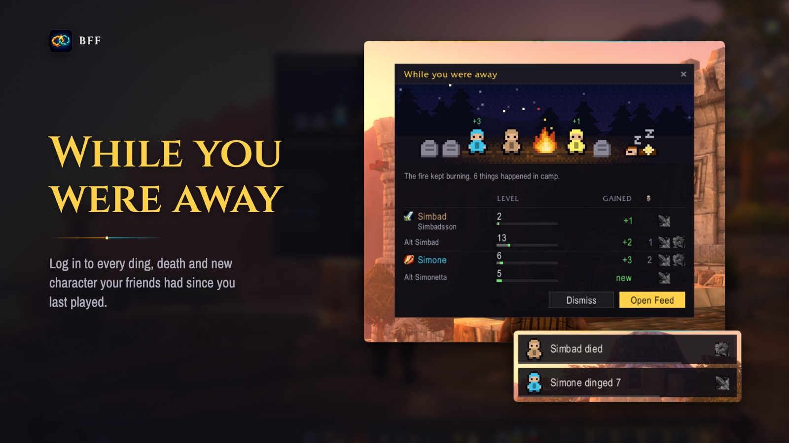
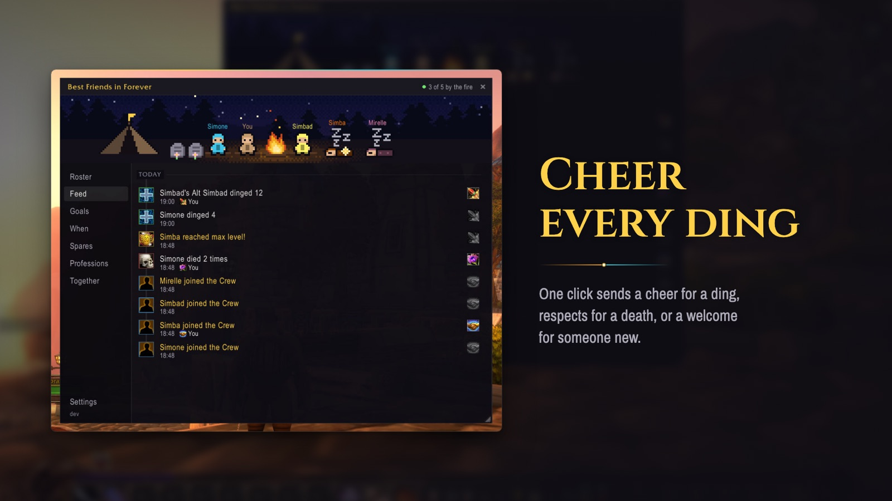
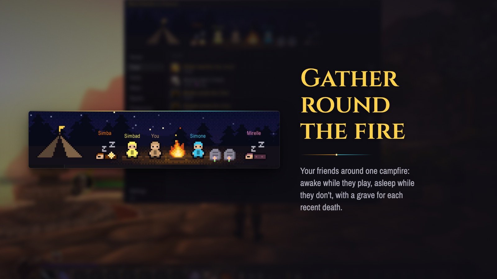
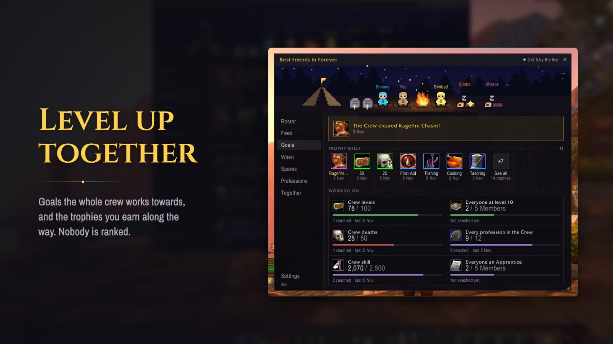
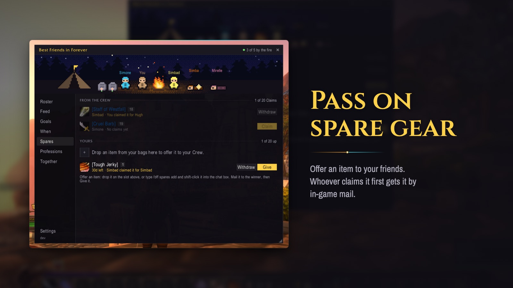
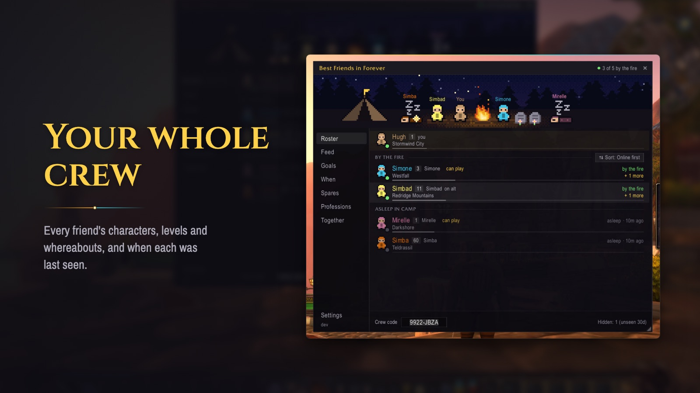
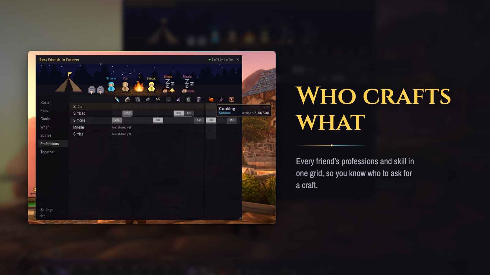
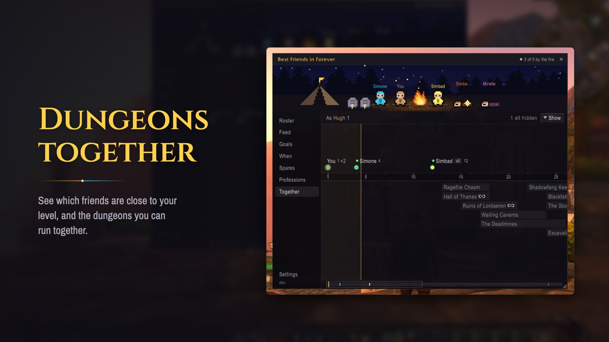
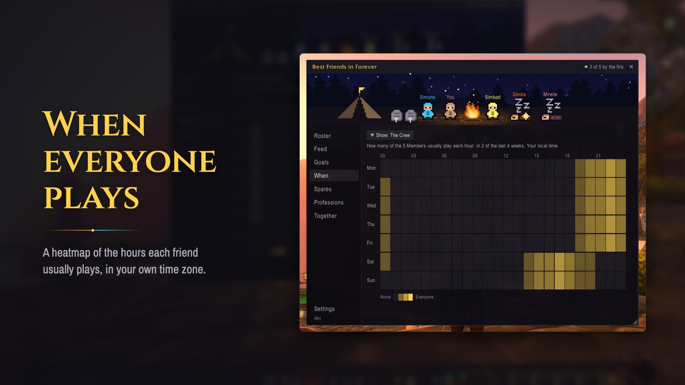
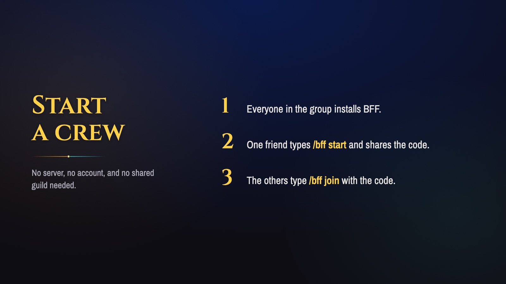

BFF is a World of Warcraft: Forever addon for a group of friends levelling side by side. It helps you keep up with each other when you play at different times, and it makes the game more social when you play together.

The heart of it is catching up. When you log in, BFF shows what happened while you were away: every ding, death and new character your friends had since you last played.

When you are online together, news arrives as it happens. A friend's ding or death pops up as a small toast with a sound, and one click sends back a reaction: a cheer for a ding, respects for a death, or a welcome for someone new. If whoever dinged has already logged off, they hear about the cheer later.

At the top of the panel the whole crew sits around a campfire, drawn as pixel art. Friends who are playing are awake, friends who aren't are asleep, and a recent death leaves a grave until somebody pays their respects with a flower.

Goals give the crew something to work towards together, and trophies mark what you did as a group, like clearing a dungeon. Nobody gets ranked. Spares let you offer a piece of gear you don't need, and whoever claims it first gets it by in-game mail.

The rest is an eagle-eye view of the crew. The roster lists every friend's characters, levels, whereabouts and when each was last seen. A grid shows everyone's professions and skill, so you know who to ask for a craft. The dungeons tab shows which friends are close to your level and the dungeons you can run together, and a heatmap shows the hours each friend usually plays, in your own time zone.

There is no server, no account and no shared guild. One friend types `/bff start` and shares a crew code, and the others type `/bff join` with it. BFF is peer-to-peer. It joins a hidden chat channel to find out who else in the crew is online, then sends each update to them as an addon whisper. Every member keeps a copy of everyone's records and passes on what they know, so news can reach you through any friend who is online at the same time as you, not only the one it happened to. The catch is that someone has to be online with you. If your play times never overlap with anyone in the crew, nothing gets through.

It is written in Lua. Almost all of the logic lives in one pure-Lua core with no WoW calls in it, so the busted test suite and an in-game simulator can run several clients against each other through a fake network. The WoW-facing code only reads the game and draws what the core tells it to. Releases are tagged on GitHub, and a GitHub Actions workflow packages the addon and publishes it to CurseForge.

Get it on [CurseForge](https://www.curseforge.com/wow/addons/bff-best-friends-in-forever), or search for BFF in the CurseForge app.
